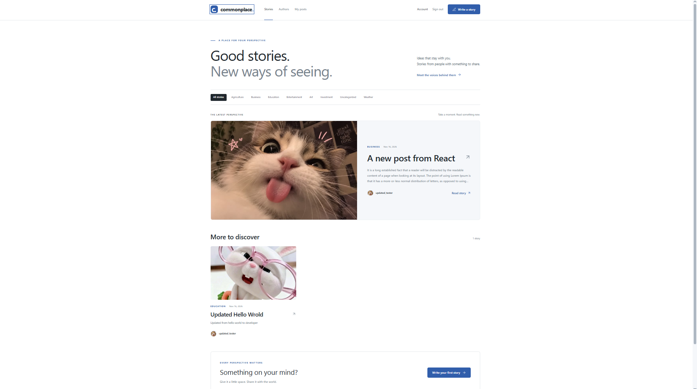
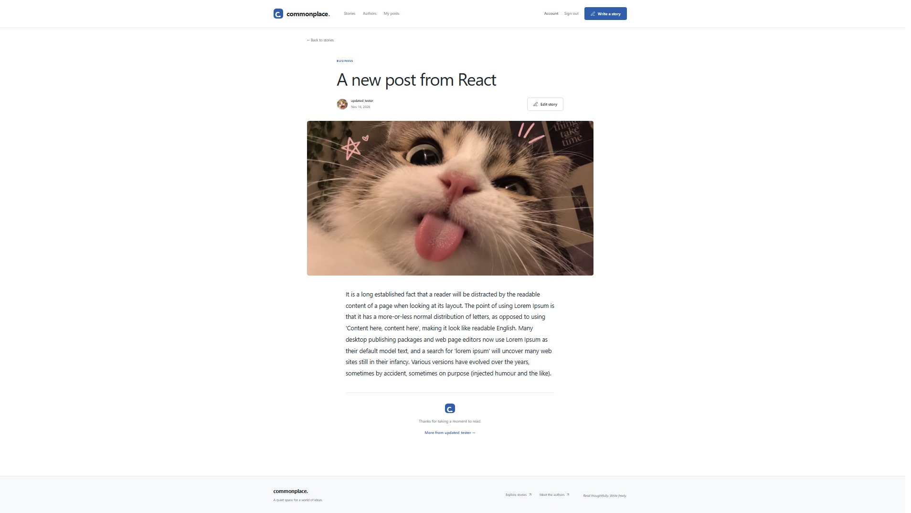
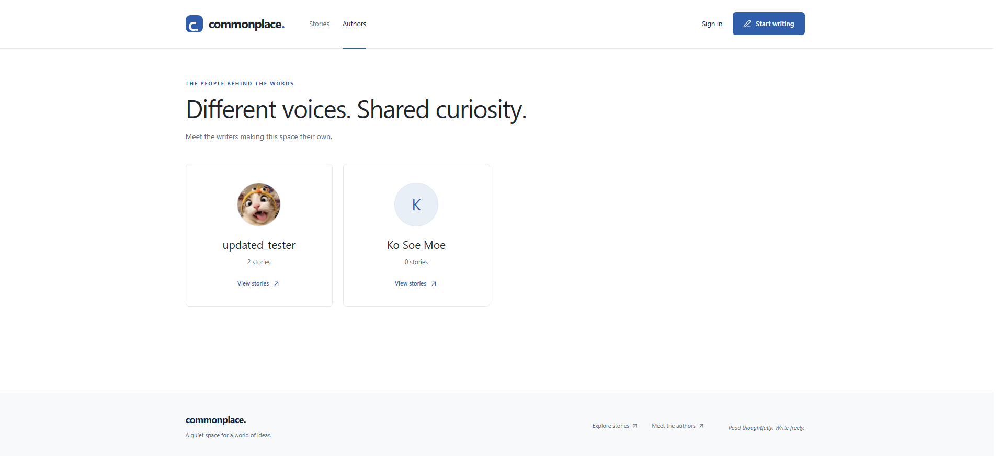
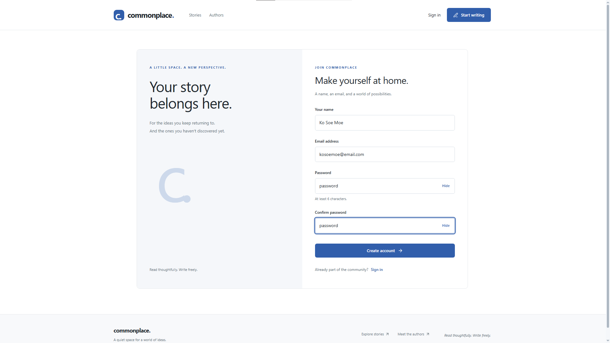
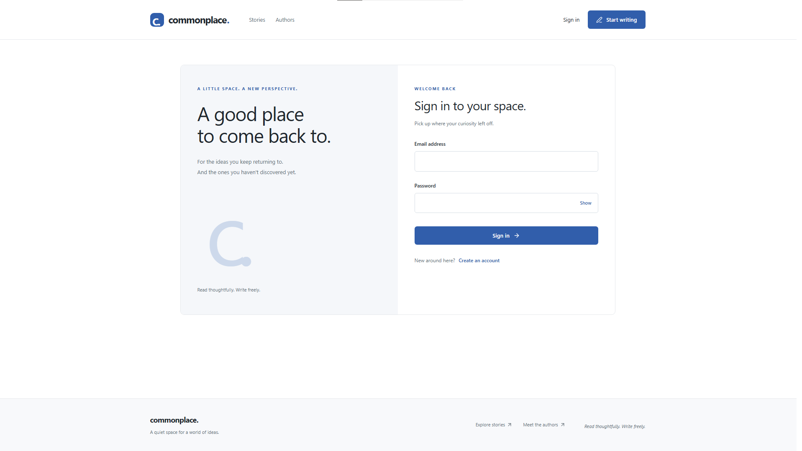
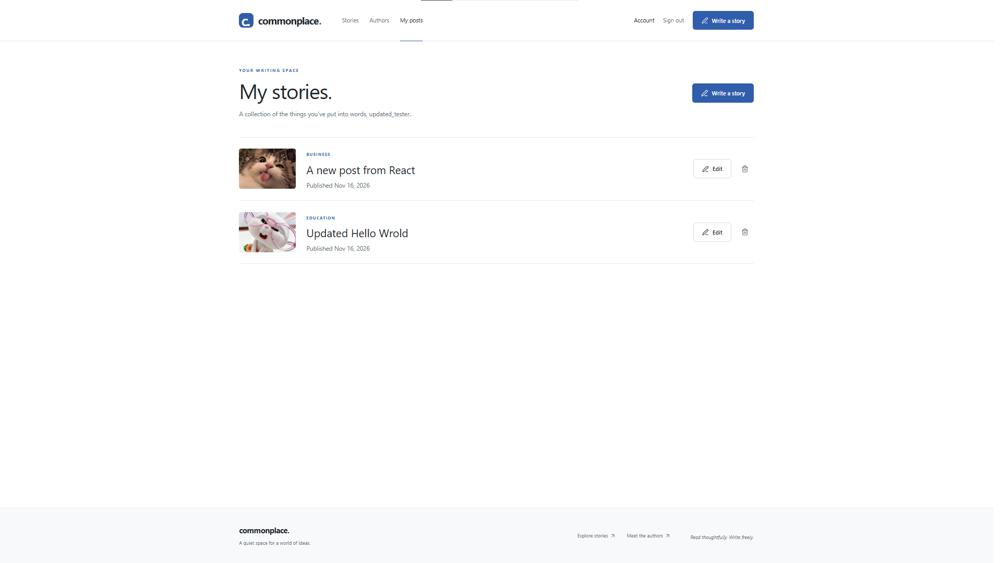
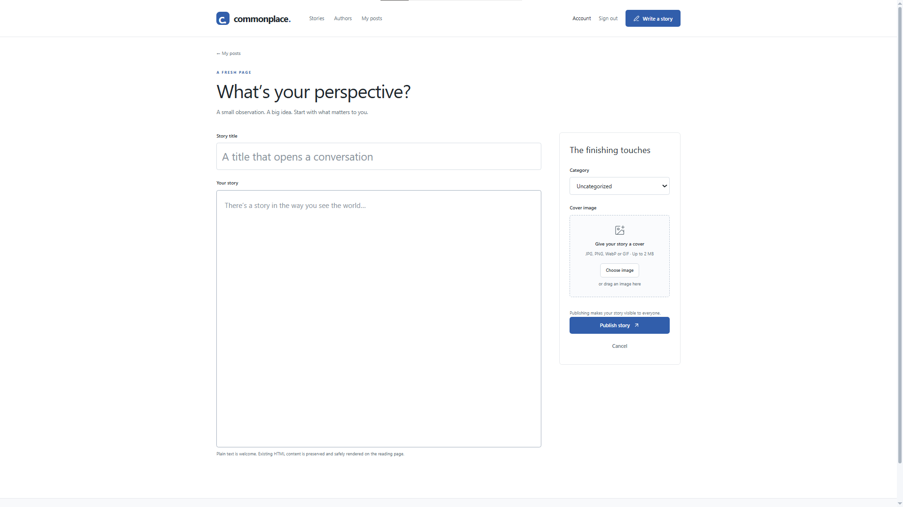
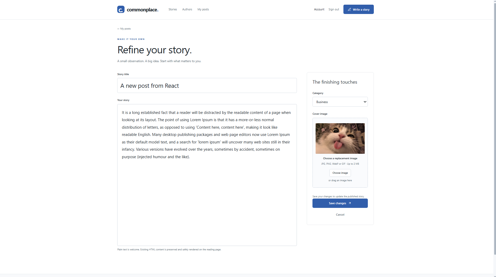

# MERN Blog — Commonplace

A multi-author blog with an Express and MongoDB server and a separate React frontend. Readers can explore stories by category or author; signed-in writers can publish and manage their own posts.

## Screenshots

### Home



<details>
<summary>Article detail</summary>



</details>

<details>
<summary>Authors</summary>



</details>

<details>
<summary>Create an account</summary>



</details>

<details>
<summary>Sign in</summary>



</details>

<details>
<summary>My stories</summary>



</details>

<details>
<summary>Write a story</summary>



</details>

<details>
<summary>Edit a story</summary>



</details>

## Project structure

```text
mern_blog/
├── server/
│   ├── controllers/    # User and post request handlers
│   ├── middleware/     # JWT authentication and error handling
│   ├── models/         # Mongoose schemas
│   ├── routes/         # Express API routes
│   ├── uploads/        # Uploaded thumbnails and avatars
│   └── index.js        # Server entry point and database connection
└── client/
    ├── public/         # Static assets
    ├── src/
    │   ├── components/ # Shared UI and layout
    │   ├── hooks/      # Form and data-loading hooks
    │   ├── lib/        # Axios configuration, payloads and utilities
    │   ├── pages/      # Blog, authentication, editor and account screens
    │   └── stores/     # Zustand session and notification state
    ├── tests/          # Unit and browser tests
    └── postman/        # Local API fixtures for browser testing
```

Each project has its own `package.json` and dependencies. Run npm commands from the corresponding directory; there is no root workspace command.

## Technology

| Server                       | Client                               |
| ---------------------------- | ------------------------------------ |
| Node.js and Express          | React and Vite                       |
| MongoDB and Mongoose         | Tailwind CSS                         |
| JSON Web Tokens and bcryptjs | Zustand and React Router             |
| express-fileupload           | Axios with multipart upload progress |
| CORS and dotenv              | DOMPurify and Lucide icons           |

## Features

- Browse the latest stories, individual articles, categories and author profiles.
- Register, sign in and sign out.
- Publish, edit and permanently delete your own posts.
- Upload a post cover image or profile photo with client-side validation and previews.
- Update account details and password through the existing combined profile endpoint.
- Responsive minimalist layouts, inline errors, loading and empty states, notifications and unsaved-change protection.

Supported categories: Agriculture, Business, Education, Entertainment, Art, Investment, Uncategorized and Weather.

Search, pagination, drafts, comments, likes, bookmarks, password recovery, admin roles and general attachments are outside the current API and are not implemented.

## Requirements

- Node.js 22.12+ and npm. Development was verified with Node.js 22.18.
- A reachable MongoDB instance, either local or hosted.
- Ports **3000** for the client and **5000** for the server by default.

## Server setup

From the repository root:

```powershell
cd server
npm install
```

Create or update `server/.env` with your own values. Preserve any existing working configuration:

```dotenv
PORT=5000
MONGO_URI=mongodb://127.0.0.1:27017/mern_blog
JWT_SECRET=replace-with-a-long-random-secret
```

| Variable     | Purpose                                     |
| ------------ | ------------------------------------------- |
| `PORT`       | HTTP port; defaults to `5000`               |
| `MONGO_URI`  | MongoDB connection string                   |
| `JWT_SECRET` | Secret used to sign and verify login tokens |

Start the server:

```powershell
npm run dev
```

The server starts listening after MongoDB connects successfully. The default API base URL is **http://localhost:5000/api**. Uploaded images are served from **http://localhost:5000/uploads/** and stored in `server/uploads/`; ensure that directory exists and is writable.

Never commit real environment secrets or put server secrets in the client configuration.

## Client setup

Open another terminal at the repository root:

```powershell
cd client
npm install
npm run dev
```

Open **http://localhost:3000**. Vite uses a fixed port of `3000`, matching the server's allowed CORS origin.

The client defaults to `http://localhost:5000/api`. To change it, copy `client/.env.example` to `client/.env` and set:

```dotenv
VITE_API_URL=http://localhost:5000/api
```

The URL must end in `/api`; uploaded images use the same host's `/uploads` path. Restart Vite after changing environment variables. All `VITE_` variables are public browser configuration.

Register an account, then sign in to publish stories. Registration does not automatically sign you in. Tokens stay in memory, so refreshing the page requires signing in again; login tokens expire after one day.

## API reference

Paths below are relative to `/api`. Protected requests require `Authorization: Bearer <token>`. Post updates and deletion also require the signed-in user to own the post.

| Method | Path                          | Authentication | Purpose                                                                        |
| ------ | ----------------------------- | -------------- | ------------------------------------------------------------------------------ |
| POST   | `/users/register`             | Public         | Register with `name`, `email`, `password`, `password2`                         |
| POST   | `/users/login`                | Public         | Sign in with `email`, `password`; returns `token`, `id`, `name`                |
| GET    | `/users`                      | Public         | List authors                                                                   |
| GET    | `/users/:id`                  | Public         | Get a user profile                                                             |
| POST   | `/users/change-avatar`        | Protected      | Upload multipart field `avatar`                                                |
| PATCH  | `/users/edit-user`            | Protected      | Update `name`, `email`, `currentPassword`, `newPassword`, `confirmNewPassword` |
| GET    | `/posts`                      | Public         | List posts, most recently updated first                                        |
| GET    | `/posts/:id`                  | Public         | Read a post                                                                    |
| GET    | `/posts/categories/:category` | Public         | List posts in a category                                                       |
| GET    | `/posts/users/:id`            | Public         | List posts by an author                                                        |
| POST   | `/posts`                      | Protected      | Publish multipart `title`, `category`, `description`, `thumbnail`              |
| PATCH  | `/posts/:id`                  | Owner          | Edit `title`, `category`, `description`; optionally replace `thumbnail`        |
| DELETE | `/posts/:id`                  | Owner          | Permanently delete a post and its thumbnail                                    |

### File uploads and editing

| Image         | Multipart field | Maximum size           |
| ------------- | --------------- | ---------------------- |
| Post cover    | `thumbnail`     | 2,000,000 bytes (2 MB) |
| Profile photo | `avatar`        | 500,000 bytes (500 KB) |

The client accepts JPEG, PNG, WebP and GIF images. Post creation requires a thumbnail. Editing without a replacement image sends JSON; image uploads use `multipart/form-data`. The client requires at least 12 characters of story text to satisfy the edit endpoint's validation.

The editor supports plain text and preserves existing stored HTML for editing. The reading page sanitizes HTML before rendering. Updating account details requires entering the current password and supplying a new password and confirmation, as required by the current server endpoint.

## Commands and checks

Run these commands from the indicated project directory.

| Directory | Command                | Purpose                                             |
| --------- | ---------------------- | --------------------------------------------------- |
| `server`  | `npm run dev`          | Run Express with nodemon                            |
| `client`  | `npm run dev`          | Run Vite on port 3000                               |
| `client`  | `npm run build`        | Build static production files into `dist/`          |
| `client`  | `npm run preview`      | Preview the production build on port 3000           |
| `client`  | `npm run lint`         | Check JavaScript and React code                     |
| `client`  | `npm run format:check` | Check formatting                                    |
| `client`  | `npm run format`       | Format client files                                 |
| `client`  | `npm test`             | Run unit tests                                      |
| `client`  | `npm run qa:api`       | Start the local Postman API simulation on port 4500 |
| `client`  | `npm run test:e2e`     | Run browser tests against the simulation            |

The server's `npm test` script is a placeholder and currently exits with an error; no server test suite is configured.

### Browser tests

Browser tests require Postman CLI 1.74+ and installed Microsoft Edge, or an alternative browser configured in `client/playwright.config.js`.

Start the fixture API from `client/`:

```powershell
npm run qa:api
```

In another terminal, also from `client/`:

```powershell
npm run test:e2e
```

Keep port 3000 free: the runner starts and stops its own Vite server. These fixtures are used only for QA and do not connect to MongoDB or supply content to the normal application. Passing fixture tests verifies client behavior against the modeled API; it does not establish live database or filesystem integration.

## Production

Set the production `VITE_API_URL` before running `npm run build`. Deploy `client/dist/` to a static host that serves `index.html` for client-side routes. The build embeds public environment values, so changing them requires rebuilding.

Run the Express API separately with Node.js, its environment configuration, a reachable MongoDB instance and persistent writable upload storage. For example, `node index.js` starts the server from `server/`. Configure the server's CORS origin for the deployed client URL; it currently allows only `http://localhost:3000`.

## Current limitations

The server returns password hashes in avatar and profile update responses. The client stores only an explicit list of safe profile fields, but the API responses still need a server-side fix. Image replacement also deletes the previous file before the replacement succeeds, and the server lacks upload content validation. Client-side checks cannot replace those server fixes.

Cancellation or a timeout does not guarantee that a write was rolled back. Check the current post or profile before retrying an uncertain request.

## Further documentation

- [Client setup and implementation notes](client/README.md)
- [Design system](client/DESIGN.md)
- [Interaction and API behavior contract](client/UX-CONTRACT.md)
- [Verification results and testing limits](client/VERIFICATION.md)

## License

See [LICENSE](LICENSE) for the repository license.
